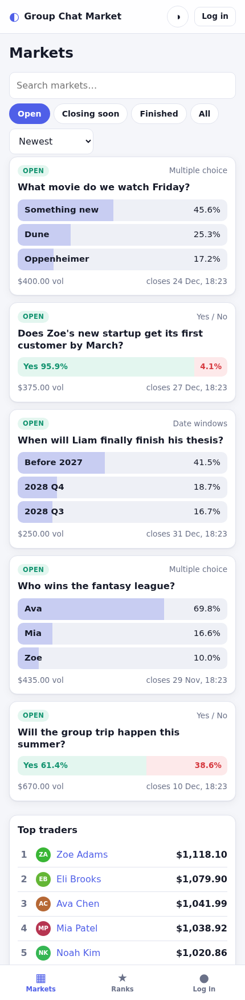
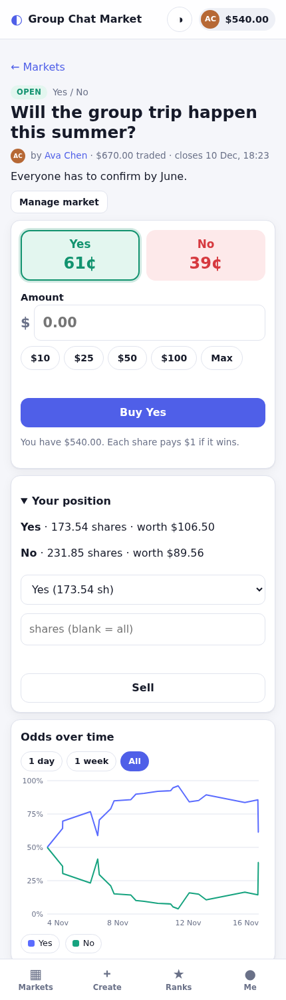
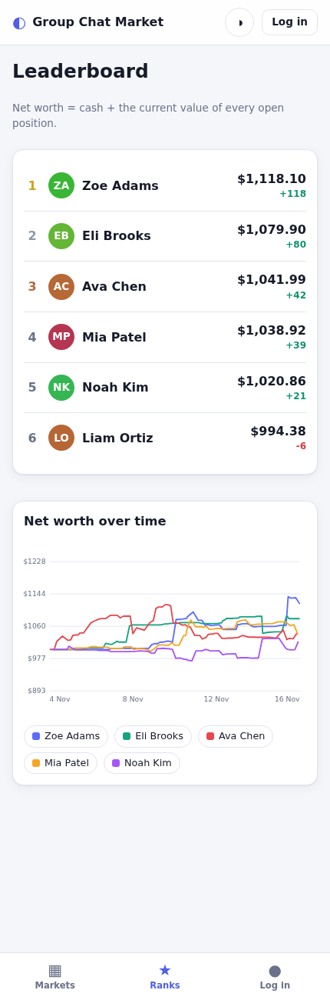

# Group Chat Market

[](https://github.com/Omar-A-Abaza/group-chat-market/actions/workflows/ci.yml)

A fake-money prediction market for your friend group. Everyone starts with play money, anyone can
create a market about anything ("Will the trip happen?", "Who wins the fantasy league?", "When will
Sam finish his thesis?"), and the group bets on the outcome. Prices move with every trade, so the odds
are the group's live opinion. Self-host it for your own group chat; no data is shared between groups.

<p>
  
  
  
</p>

## Features

- **Create any market.** Yes/No, multiple choice, or date windows ("when will it happen?", one option
  per quarter). Optional description, close time, and starting odds.
- **Fair, live prices.** An automated market maker (LMSR) sets the price of every option, so you can
  always buy or sell instantly, with no counterparty needed. See [the math](docs/ARCHITECTURE.md#pricing-lmsr).
- **Full market lifecycle.** Open, then closed (at the close time), then resolved by the creator, or cancelled with
  everyone refunded exactly what they spent. Date-window options expire automatically as time passes.
- **"About you" markets.** Mark a market as being about someone; they can watch but can't bet on it.
- **Invite links.** The host creates a link, anyone who opens it can sign up. A first-run page creates the
  admin, so there is nothing to seed by hand.
- **Leaderboard and profiles.** Net worth over time, open positions with profit/loss, trade history, CSV export.
- **Discussion on every market**, a live "you'd win $X" preview before betting, light and dark themes, and a
  mobile-first layout (the group is on phones).
- **No external services or CDNs.** The charts are drawn in plain SVG; the only dependencies are Python packages.

## Run it

You need Python 3.12 or newer.

```bash
python -m venv .venv && source .venv/bin/activate
pip install -r requirements.txt
cp .env.example .env            # set SECRET_KEY (and GROUP_NAME, START_CASH if you like)
gunicorn --workers 1 --threads 4 --bind 0.0.0.0:8000 wsgi:app
```

Open `http://localhost:8000`: the first visit shows a setup page where you create the admin account.
Then open **Admin, Invite friends** and send the link to your group chat.

With Docker: `cp .env.example .env && docker compose up -d` (data lives in the `market-data` volume).

> Keep gunicorn at **one worker**. The lock that keeps trades consistent lives in process memory; threads are fine.

### Putting it on the internet

Anything that can reach port 8000 works. A [Cloudflare quick tunnel](https://developers.cloudflare.com/cloudflare-one/connections/connect-networks/do-more-with-tunnels/trycloudflare/)
(`cloudflared tunnel --url http://localhost:8000`) gives you a free temporary HTTPS link; a named tunnel with
your own domain gives you a permanent one. If you serve over HTTPS, set `SESSION_COOKIE_SECURE=1`.
`deploy/` has example systemd user units for running it on a Raspberry Pi or home server.

### Configuration (`.env`)

| Variable | Default | Meaning |
|---|---|---|
| `SECRET_KEY` | none | Required in production. Signs sessions. |
| `GROUP_NAME` | Group Chat Market | Shown in the header and page titles. |
| `START_CASH` | 1000 | Play money for each new account. |
| `DEFAULT_B` | 250 | Default liquidity: higher means odds move less per dollar. |
| `DATABASE_PATH` | `instance/market.db` | SQLite file. |
| `SESSION_COOKIE_SECURE` | 0 | Set to 1 when served over HTTPS. |

### Useful commands

```bash
flask --app wsgi create-admin NAME     # admin without using the setup page
flask --app wsgi reset-password NAME   # prints a new random password
flask --app wsgi seed accounts.toml    # bulk-create users from a TOML file (see accounts.example.toml)
flask --app wsgi check-markets         # close expired markets / expire date windows (also runs every 5 min in the server)
flask --app wsgi demo-data             # fill an EMPTY database with fake users, markets and trades
```

## How betting works, in one minute

Each option has a price between 0 and 1 (shown as a percentage, or cents for Yes/No), and all the prices
in a market add up to 100%. Buying an option pushes its price up; selling pushes it down. Each share of the
winning option pays $1 when the market resolves, everything else pays $0. So buying a 20¢ option that wins
returns 5x your money, while a 90¢ option that wins only returns about 1.1x. Your net worth is your cash plus
what your shares are worth at the current prices.

## Tech

Flask, Flask-Login, Flask-SQLAlchemy (SQLite), Flask-WTF (CSRF), Jinja templates, vanilla JavaScript and
hand-written SVG charts, gunicorn. A pytest suite covers the pricing math, trading rules, market lifecycle,
auth, invites, rate limiting and the HTTP routes; CI runs it on every push.

```
app/
  market_math.py   pure LMSR functions (no database)
  models.py        users, markets, options, positions, trades, comments, invites, snapshots
  markets.py       creating and configuring markets (option templates, validation)
  trading.py       buy / sell / resolve / cancel / auto-close, all under one lock
  views.py         pages and JSON endpoints     admin.py  invites and user management
  auth.py          login, first-run setup, invite signup     ratelimit.py  login throttling
  static/          style.css (design tokens, light/dark) and app.js (bet panel, SVG charts)
tests/             pytest suite
docs/ARCHITECTURE.md   design notes
```

Design notes, the data model and the security model are in [docs/ARCHITECTURE.md](docs/ARCHITECTURE.md).

```bash
pip install -r requirements-dev.txt && pytest
```

## Ideas for later

See [docs/ROADMAP.md](docs/ROADMAP.md): notifications, portfolio chart, achievements, limit orders, tags,
seasons, audit log, public API and more.
